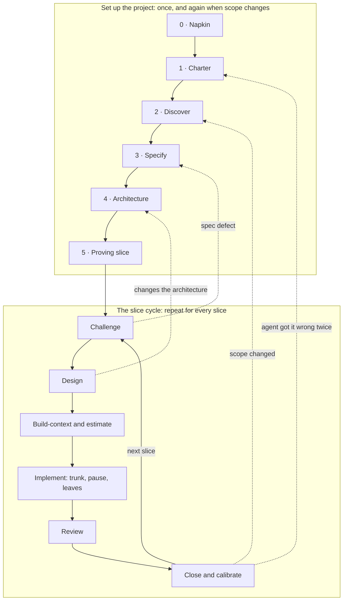

# Spec-Driven Development (`sdd`)

Claude Code skills for building software with an AI agent without letting it invent your requirements or pile up code nobody understands. The agent drafts; you decide. Every decision that belongs to a person (what a stakeholder wants, how the system is shaped, every estimate, whether code is right) is a gate the skills stop at.

It works for **application, data engineering, and ML projects**, and for a mix: a **slice** (the unit of work) is a use case for a feature, a data contract for a pipeline, or a model contract for a model.

## The cycle



The full method, the gates, and how to size it to a bug fix, an experiment, or an existing codebase: [`skills/lifecycle/references/cycle.md`](skills/lifecycle/references/cycle.md). How each step changes for data and ML: [`skills/lifecycle/references/project-types.md`](skills/lifecycle/references/project-types.md). How to use each skill: [`USAGE.md`](USAGE.md).

## The skills

| Skill | Step | What it produces |
|---|---|---|
| `lifecycle` | Where am I? Napkin, set up `docs/`, proving slice | A diagnosis of the repository and the next step |
| `charter` | 1 | `AGENTS.md` + `CLAUDE.md`, `.claude/settings.json` deny rules, team contract |
| `discovery` | 2 | Interview records, glossary, vision and scope, open issues, business rules |
| `specification` | 3 | Slice list; use cases, data contracts, or model contracts; requirements; traceability |
| `architecture` | 4 | The architecture-of-record (arc42 structure, C4 diagrams, ranked requirements, key decisions) |
| `design` | Slice | The design-of-record per area; experiments and spikes |
| `build` | Slice | Estimates, build-context issues, trunk-and-leaf implementation, review, close and calibration |
| `slice` | Slice | Where one slice is, and its next gate |

Each skill copies its template (bundled in the skill, or the project's own if `AGENTS.md` names one), drafts only what the template lets an agent draft, and stops for the rest.

## Install

The repository is private; access is by GitHub collaborator.

1. **One-time, on each machine:** sign in to a GitHub account that has access, and let git use it:
   ```bash
   gh auth login
   ```
   ```bash
   gh auth setup-git
   ```
2. **In Claude Code:**
   ```
   /plugin marketplace add MattStaff0/se-lifecycle-skills
   /plugin install sdd@spec-driven-dev
   ```
3. **Use it:** in any repository, ask "where are we in the lifecycle?", or call a skill by name (`/sdd:design`).

**Updates:** `/plugin marketplace update spec-driven-dev`, or turn on auto-update for the marketplace under **Marketplaces** in `/plugin`.

## Course profile

For TCU's COSC 40943, set `**Profile:** cosc-40943` in the project's `AGENTS.md`: the skills then read the course's templates live (they are not copied here), follow its calendar and checkpoints, and apply its rules. See [`skills/lifecycle/references/profiles/cosc-40943.md`](skills/lifecycle/references/profiles/cosc-40943.md).

## Attribution

The method follows the spec-driven, agent-assisted approach taught in Bingyang Wei's COSC 40943 at TCU, including the Napkin and the trunk-and-leaf build. The `/design` and `/implement` commands and the `AGENTS.md` layering are adapted from Project Pulse by Bingyang Wei ([Washingtonwei/project-pulse](https://github.com/Washingtonwei/project-pulse)), licensed under the Apache License 2.0; see [`NOTICE`](NOTICE). The document templates are original, following public structures: arc42 and C4 for architecture, EARS for requirements, Conventional Comments for review.
