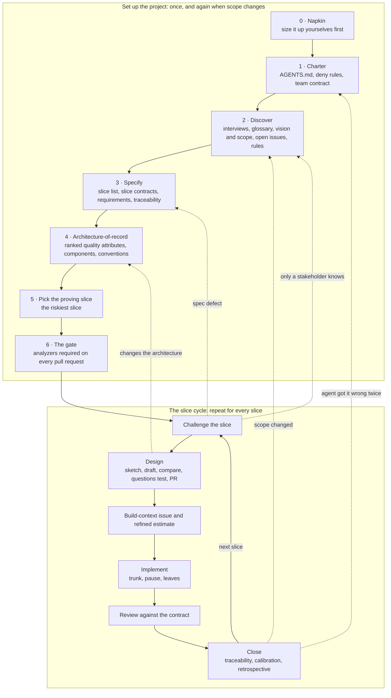

# The spec-driven cycle

**In one sentence:** name every part of the system at shallow depth (requirements and an architecture), prove it with one working vertical slice, then build one slice at a time, looping every fix back into the requirements and the architecture.

A **slice** is the unit of work, cited, designed, built, tested, and closed as one: a **use case** for an application feature, a **data contract** for a pipeline or data product, or a **model contract** for an ML model. `project-types.md` says how each step changes for each kind.

## The cycle

The gate goes on with the proving slice's first code, before the first feature merges, so no baseline is ever needed. Solid arrows are the forward path. Dotted arrows are where a problem found late is fixed where it started, before the cycle picks up again. The spec, the architecture, and the code are kept in agreement all the time.

| Step | Skill | Where the human decides |
|---|---|---|
| 0 Napkin | `lifecycle` | Your own napkin before the agent's; what each difference means |
| 1 Charter | `charter` | What the team actually agreed; the deny-rule test |
| 2 Discover | `discovery` | Which questions are worth a stakeholder's time; every number; scope |
| 3 Specify | `specification` | The slice list reviewed by stakeholders before detail; priorities; every threshold |
| 4 Architecture | `architecture` | The ranking of quality attributes; every key decision |
| 5 Proving slice | `lifecycle` | The pick |
| 6 The gate | `static-analysis` | Which tools; every verdict that is not a fix; the workflow read line by line; the ruleset on the main branch |
| Design | `design` | Your sketch first; accepting the shape; key decisions; the questions test; a teammate's merge |
| Estimate, build, review, close | `build` | Every hour; the trunk pause; every new dependency; the merge; the retrospective |

## Rules for every step

1. **The repository is the only memory.** A decision not written in the repo does not exist for the agent.
2. **Never answer for the stakeholder.** A policy, number, or priority only a stakeholder knows becomes an `OI-*` in the open-issues file.
3. **Cite, never copy.** Refer to slices, rules, requirements, and decisions by ID.
4. **Pin or derive.** If guessing a detail wrong would break a requirement, the spec or design pins it; otherwise the agent derives it.
5. **Think before you prompt.** Napkin, design sketch, reviews: yours first, then compare with the agent's.
6. **Fresh session per step** (`/clear` between design, implementation, and review).
7. **Plan mode for anything multi-step** (Shift+Tab): propose before writing.
8. **You sign it.** You can explain every line merged under your name; merging is a person's decision.

## The Napkin

Six prompts, about twenty minutes, before the agent sees the problem: **Shape** (what kind of system, in three to five boxes), **The hard part**, **Bottleneck** (where it breaks first: load, scale, data volume, or the team), **Stack** (a boring default unless there is a reason), **Kill risks** (the top three, each a mechanism, not a category), **Verdict** (feasible or not, and what you would cut first). Each person writes theirs silently, the team reconciles, then the agent drafts its napkin with the real constraints (budget, existing systems, deadline, who operates it, the team's skills, the definition of done), and you diff the two both ways. *(The Napkin is adapted from Bingyang Wei's COSC 40943 at TCU.)*

## When something changes: where to re-enter

| The change | Go back to |
|---|---|
| Inside one area, no ranked quality attribute affected | **Specify**: amend the slice contract, then revise that area's design through its gate |
| Adds an area, a component, an external system, or a crosscutting concern, or re-ranks a quality attribute | **Architecture** first, before any design builds on it |
| Overturns a key decision | **Architecture**: a new `KD-*` that supersedes the old one |
| Changes scope | **Discover**: vision and scope first, so new slices trace to a feature |
| The agent made the same mistake twice | **Charter**: a new rule, in its own small pull request |
| A question only a stakeholder can answer | **Discover**: an `OI-*`, and the next conversation's agenda |
| An experiment's result changes what is possible | **Specify** or **Architecture**, with the result recorded |

## Sizing the cycle to the work

| The work | Keep |
|---|---|
| A bug fix | No design step. If a slice contract covers the behavior, fix the code, add a regression test, cite the contract. If none does, add the missing extension or failure mode first. |
| A small change inside one area | Amend the contract and add a row to its design's test list. |
| An experiment or spike | A time-box, a hypothesis, and a written result (`design/templates/experiment.md`). Notebook code is evidence, never production: the result goes into the spec or a decision, and the code is rebuilt through the slice cycle. |
| A small project (one or two people, short-lived) | A floor of three: the charter (opening with a short vision and scope), slice contracts with their failure paths and inline rules, and a test list per slice. |
| A team, real stakeholders, a long-lived system | The full cycle. |
| An existing codebase with few docs | Recover the documents from the code, but **the code is evidence, never authority**: a stakeholder calls each recovered behavior intended, corrected, or a defect. Put the gate on with a baseline that only shrinks (`static-analysis`), then run the cycle as usual. |

## One slice at a time

1. **Design:** challenge (report only) → the developer sketches → the agent drafts in plan mode → compare → the questions test in a fresh session → pull request merged by someone who did not write it. No implementation starts before that merge.
2. **Build-context and refined estimate:** the issue cites the slice and the design and stops there.
3. **Implement:** the trunk (code many paths depend on) in its own commit, **pause**, a security rule or schema migration alone, then one commit per leaf, each with its tests.
4. **Review** against the contract: the triage line and the checklist.
5. **Close:** honest traceability (built is not verified), hours since each estimate ÷ its midpoint, a five-minute retrospective, a charter rule for anything corrected twice, the plan revised. Then `/clear`.
